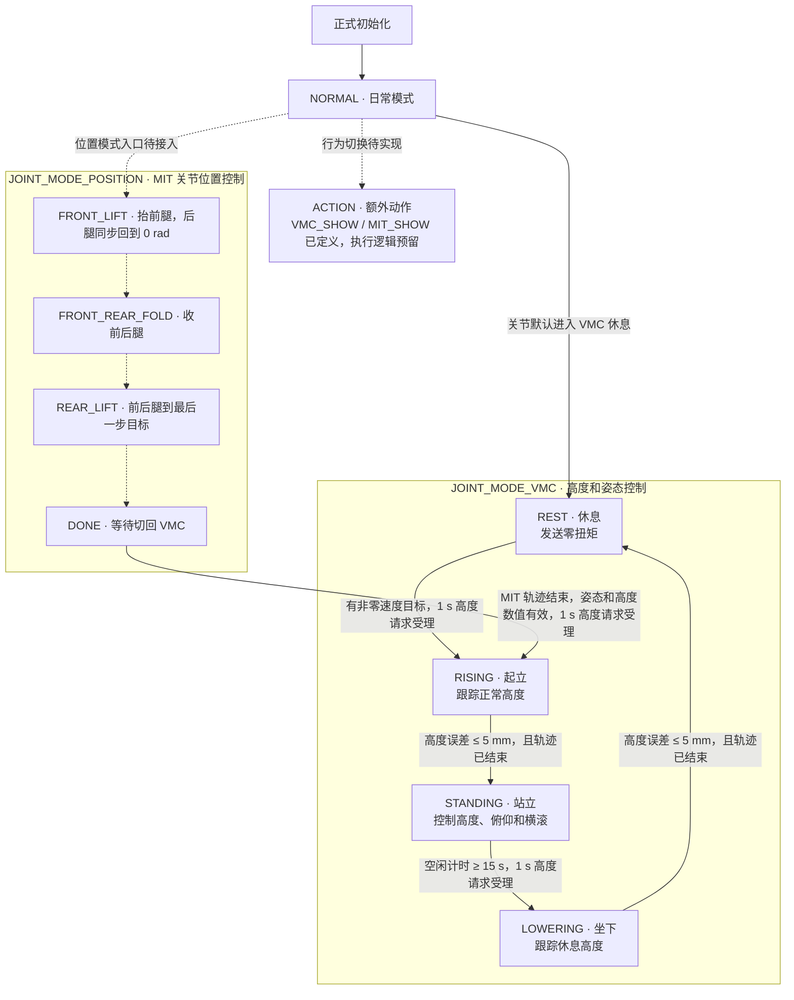
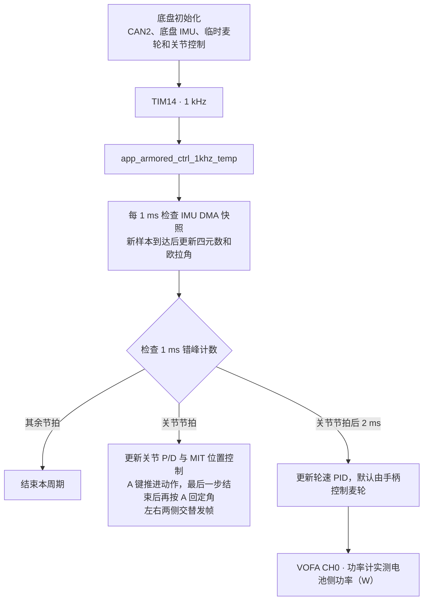

# 重装底盘状态机框架

当前默认配置为 `BOARD_CHASSIS + ROBOT_HERO`，系统调度运行的是临时调参入口。正式入口已能更新 IMU，行为分发和四毫秒控制调度仍待接入。下面分别画出正式状态机和当前执行路径。

## 正式状态机

实线表示状态执行函数里已有的切换条件。虚线表示模式归属或待接入的切换，具体含义标在箭头上。

- **VMC** 在起立和站立时使用 `target_height_mm`，坐下时使用 `rest_height_mm`。有速度目标会清零站立空闲计时，但累计计时的调度还没接入。正常高度目前是 `0 mm` 占位值，休息高度在正式初始化时尝试从关节反馈计算。
- **MIT** 的三个步骤共用一个执行函数。临时模式下第一次按 A 直接进入 `FRONT_LIFT`。当前用轨迹完成判断可否切步，没有用实测角度判定到位。
- **MIT → VMC** 在 `DONE` 中已有实现。等待期间继续运行 MIT 并保留现有目标。切换成功后进入 `RISING`，由 VMC 从当前高度平滑过渡到正常高度。
- **麦轮行走** 是独立的控制维度，已定义车体坐标系和世界坐标系。正式入口中的遥控输入映射、坐标系切换和麦轮调度仍待接入。

## 当前执行路径

关节和麦轮控制各每 4 ms 执行一次。麦轮在关节之后 2 ms 发送，VOFA 紧随麦轮。关节左右两侧交替发送，所以每个关节每 8 ms 获得一次指令发送机会。IMU 更新独立于这一分频。正式入口 `app_armored_ctrl_1khz()` 和临时入口共用 AHRS 更新函数。

源码对应 [重装控制](chassis/app_Armored_ctrl.c)、[关节控制](chassis/app_Armored_joint.c)、[系统初始化](../common/system/app_init.c) 和 [周期调度](../common/system/app_control.c)。
